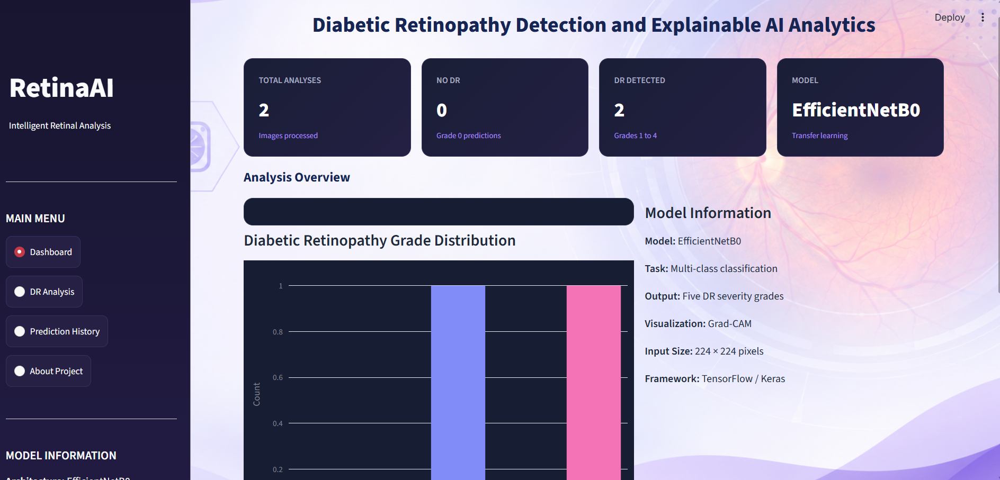
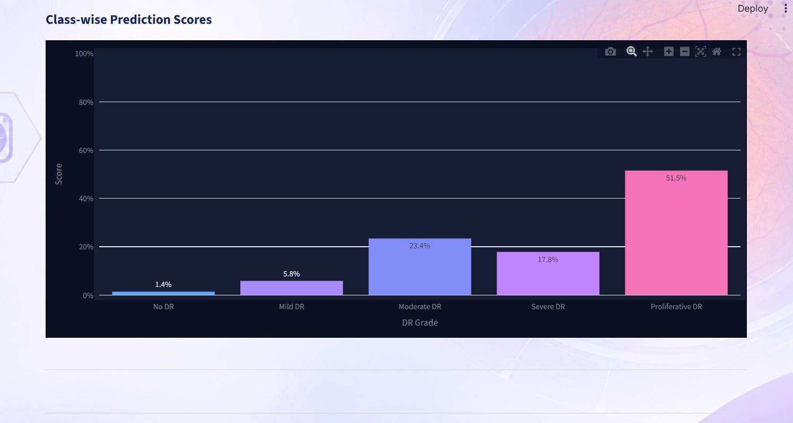
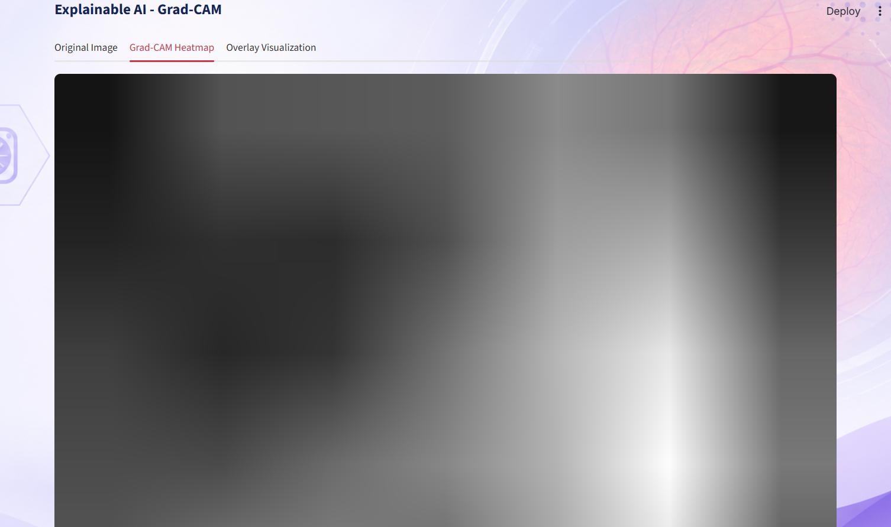
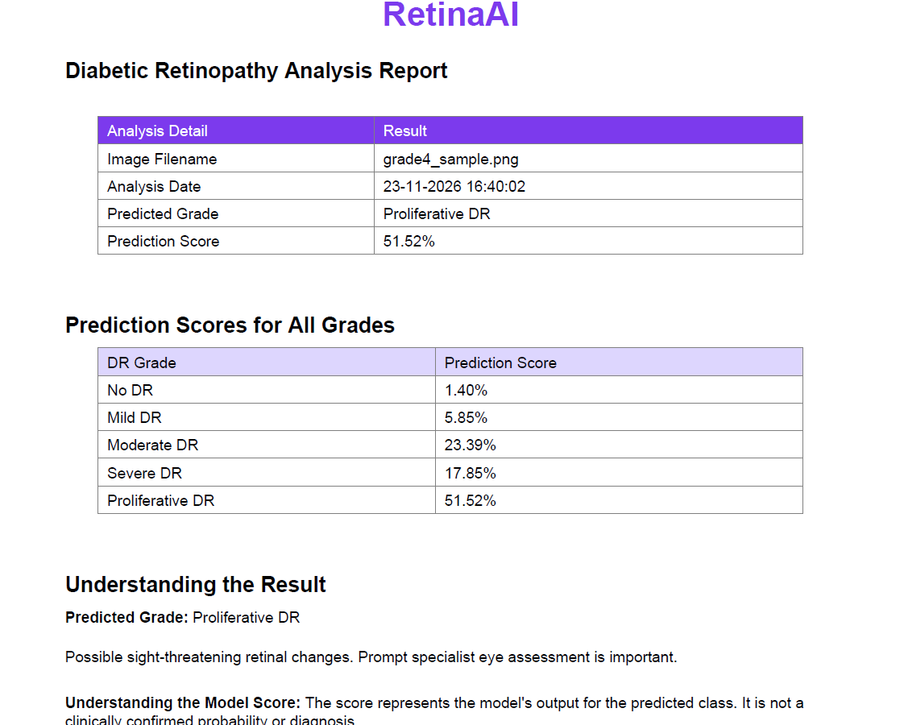

# RetinaAI – Diabetic Retinopathy Detection & Explainable AI

An AI-powered web application that detects and classifies Diabetic Retinopathy from retinal fundus images using Deep Learning and Explainable AI.

## About the Project

RetinaAI is a Deep Learning-based project designed to classify diabetic retinopathy into five severity levels using retinal fundus images.

The application uses an EfficientNetB0 model for image classification and Grad-CAM (Gradient-weighted Class Activation Mapping) to visualize the regions of the retinal image that influenced the model's prediction.

The project provides an interactive dashboard for image analysis, prediction visualization, result interpretation, and PDF report generation.

## Features

- **Retinal Image Upload:** Upload retinal fundus images in JPG, JPEG, and PNG formats.
- **AI-Based Detection:** Predict diabetic retinopathy using EfficientNetB0.
- **Five-Class Classification:** Identify the predicted DR severity grade.
- **Grad-CAM Visualization:** Generate heatmaps to understand model attention.
- **Overlay Visualization:** Display Grad-CAM heatmaps over the original retinal image.
- **Prediction Score Distribution:** Visualize model scores for all five classes.
- **Analysis Dashboard:** View prediction statistics and analysis history.
- **Result Interpretation:** Understand the predicted classification.
- **PDF Report Generation:** Download the analysis report.

## DR Classification Levels

The model classifies retinal images into five categories:

| Grade | Classification |
|---|---|
| 0 | No DR |
| 1 | Mild DR |
| 2 | Moderate DR |
| 3 | Severe DR |
| 4 | Proliferative DR |

## Technologies Used

- Python
- Streamlit
- TensorFlow / Keras
- EfficientNetB0
- Grad-CAM
- NumPy
- Pandas
- Plotly
- OpenCV
- Pillow

## Dataset

The project uses the APTOS 2019 Blindness Detection dataset as its retinal image dataset.

## Project Structure

```text
RetinaAI/
│
├── app.py
├── gradcam.py
├── diabetic_retinopathy_model.keras
├── requirements.txt
├── retinaai_background.png
├── .gitignore
└── README.md
```

## Installation and Setup

### 1. Clone the repository

```bash
git clone https://github.com/chagantisathvika-source/RetinaAI.git
```

### 2. Navigate to the project folder

```bash
cd RetinaAI
```

### 3. Create a virtual environment

```bash
python -m venv .venv
```

### 4. Activate the environment

Windows:

```bash
.venv\Scripts\activate
```

### 5. Install dependencies

```bash
pip install -r requirements.txt
```

### 6. Run the application

```bash
python -m streamlit run app.py
```

The application will open in your browser.

## Explainable AI – Grad-CAM

RetinaAI integrates Grad-CAM to provide visual explanations of model predictions.

- **Heatmap:** Highlights regions receiving attention from the model.
- **Overlay:** Combines the heatmap with the original retinal image.

These visualizations help users understand which image regions influenced the prediction. They do not independently establish the presence or severity of retinal damage.

## Future Enhancements

- Integration with cloud-based deployment.
- Improved model performance and validation.
- Additional explainability techniques.
- Enhanced user interface and reporting features.

## Disclaimer

RetinaAI is an academic project developed for educational and research purposes. It is not a clinically validated diagnostic system and must not be used as a substitute for professional medical examination or advice.


## Website Screenshots

### 1. RetinaAI Dashboard


### 2. Diabetic Retinopathy Analysis


### 3. Prediction Graph


### 4. Grad-CAM Heatmap


### 5. Overlay Visualization


### 6. Analysis Report



## Author

**Sathvika Chaganti**

GitHub: https://github.com/chagantisathvika-source

---

⭐ If you find this project interesting, consider giving the repository a star!
